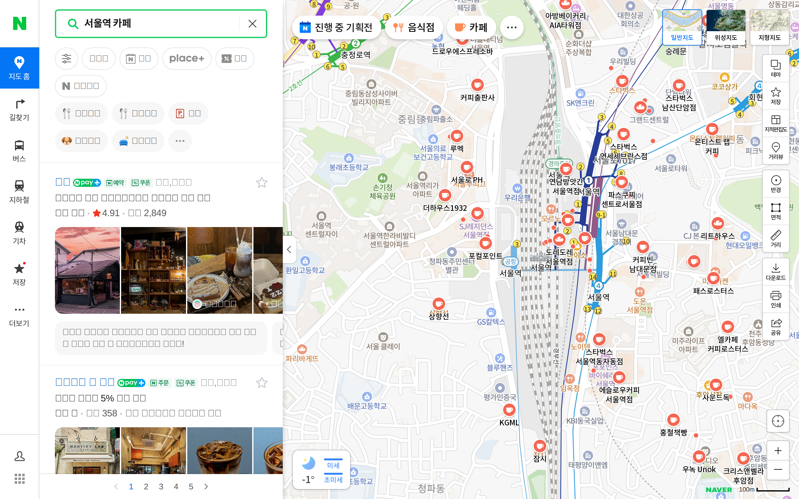

# Authentication diagnosis, 19 November 2026

The controlled public browser navigation returned café results while signed out.
No login or verification challenge was shown. There is no evidence from this
navigation that an account is blocked or that public search requires login.

The page's `searchIframe` points at `pcmap.place.naver.com/place/list`.
Top-page resource timing entries include HTTP 200 for
`/p/api/search/query-analyze`, `/p/api/search/bubble-keyword-list`, and
`/p/api/login/simple`. They did not include the configured legacy
`/p/api/search/allSearch` endpoint. Cross-origin iframe response bodies were not
available through the preview tool, so this observation alone does not establish
the new response payload or validate a replacement extractor. Capture drift is
being handled separately by the parent integration branch.

One actual connected `naver_map_search` call for `서울역 카페`, page 1, returned
`isError=true` with the generic timeout message. The gateway's corresponding
outcome at `2026-11-19T18:07:00.55200444Z` recorded `failure_category=timeout`,
`failure_stage=worker_startup`, and `search_ms=0` (correlation
`7a9ab5d15258776c`). It never reached NAVER. It is neither a successful MCP
search nor evidence of an expired account session. The saturated host was
subsequently observed with load average 24.72 and 70% I/O wait; those timings are
not performance benchmarks.

The auth change adds optional persistence of a legitimate Chrome profile and
specific failure categories when a critical response actually returns HTTP
401/403/429 or the browser displays login/verification evidence. It leaves
unrecognized capture failures as capture failures and does not require login
for public search. These upstream failure categories were not encountered in
the controlled navigation; they are not claimed as live-validated account
recovery.

Validation completed without unit tests:

- `bash gradlew bootJar --no-daemon --max-workers=1` succeeded.
- `GOMAXPROCS=1 go build -p=1 -o ../build/auth/naver-maps-mcp ./cmd/gateway`
  succeeded from `gateway/`.
- `bash -n scripts/naver-session-login.sh` and `git diff --check` passed.
- A Luna High implementation helper created the operator script and recovery
  guide; a separate Luna High reviewer reported no concrete blockers.
- An isolated loopback gateway built from this auth source successfully handled
  real MCP `initialize` and `tools/list` requests and discovered both tools.
  With `NAVER_MAP_SELENIUM_USER_DATA_DIR=relative-profile`, an actual
  `naver_map_search` request started the real Java worker and returned the
  actionable `session_configuration` message through the MCP gateway. See the
  [actual MCP response](evidence/auth-2026-11-19-invalid-profile.json). The path
  was rejected before `new ChromeDriver`, so this check made no NAVER requests.
  The isolated gateway and worker were stopped after the check.

The exact built Java JAR SHA-256 is
`b094c8a6fc12815e8f49a81fb8ccdbdfe1629205a0a6f84ce8dc6dcda2ce679b`.
No credentials, account cookies, or profile files were collected or committed.
