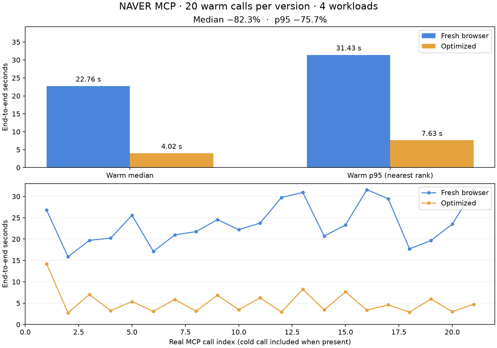
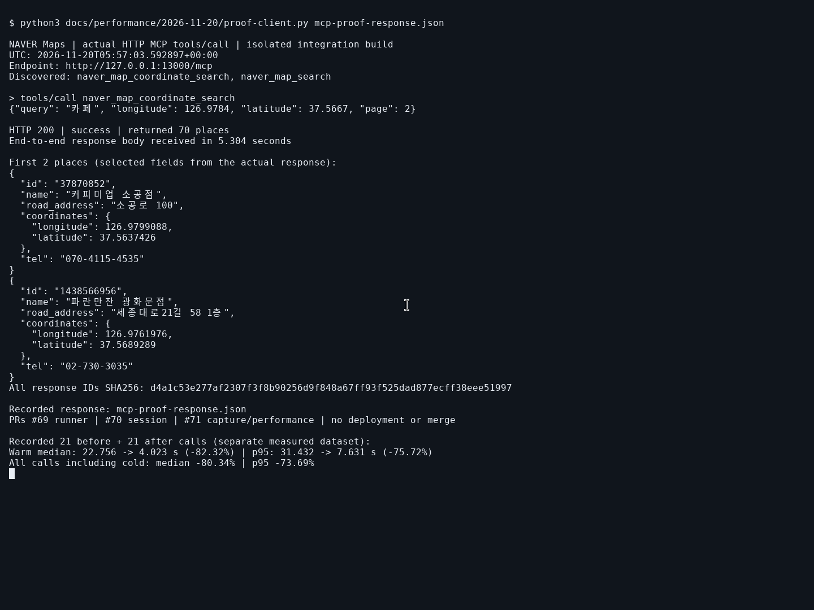

# Live MCP restoration and latency verification

This directory records real HTTP MCP calls on Yatin's Ubuntu host. The deployed
v0.1.1 service was left unchanged. PRs #69 (runner), #70 (session recovery), and
#71 (capture/performance) form the review/merge stack **#69 → #70 → #71**.

## Recorded results

Both runs passed **21/21 actual MCP calls**, with 70 unique places per response.
All optimized page-two calls returned 70 IDs absent from their corresponding
first page. All four optimized workloads had stable full normalized result
hashes across rounds; keyword hashes also match the baseline exactly.

| Sample set | Metric | Before | After | Reduction |
| --- | --- | ---: | ---: | ---: |
| 20 warm worker calls | median | 22.756 s | 4.023 s | 82.32% |
| 20 warm worker calls | p95 | 31.432 s | 7.631 s | 75.72% |
| All 21 calls, including cold | median | 23.303 s | 4.580 s | 80.34% |
| All 21 calls, including cold | p95 | 31.432 s | 8.270 s | 73.69% |
| Separate cold call | wall time | 26.780 s | 14.182 s | 47.04% |

Warm means the Java worker remains running; the baseline still starts a fresh
browser on every call. The 50% median/p95 target is met for both the warm and
all-call sample sets. It is not a claim that every individual request or cold
startup is at least 50% faster.



Raw evidence: [before](before.json), [after](after.json), [all 42 calls as CSV](wall-clock.csv),
[before phases](before-stages.json), [after phases](after-stages.json), and
[initial repaired five-call smoke](initial-repaired-smoke.json). The initial
smoke's hash is the source cited in PR #70; it is retained without altering it.

Measured source: `0407579` (both reports recorded a clean checkout).
Gateway SHA-256: `8ce048f2eec2c76e37311ef5ecec73d835005924aee2ce4c2392ce9e3569ebe6`.
Java JAR SHA-256: `d43c1051598b8cb2f71e543f0a19ea1736969b8d32a61b1715c9eecd7f984e70`.
The differing flags isolate the full-Maps/fresh-browser baseline from the new
public-results/reuse behavior in exactly the same built source/artifacts.

Independent Luna High review of the final measured source found no concrete
correctness, security, or reliability blockers. No unit tests were created or run.

## Measurement method

`scripts/benchmark-mcp.py` initializes an actual MCP session, discovers both
search tools, then issues sequential `tools/call` requests. `perf_counter_ns`
measures from HTTP request dispatch through receipt of the complete JSON/SSE
response body. JSON parsing, validation, hashing, and the three-second interval
between calls are outside that timer. No retries are made. The client stops on
its first transport, tool, or validation failure.

Each run has one separately reported cold keyword call followed by five rounds
of these four workloads (20 warm samples):

| Tool | Query | Page | Coordinate input |
| --- | --- | --- | --- |
| `naver_map_search` | 노원역 맛집 | 1 | none |
| `naver_map_search` | 노원역 맛집 | 2 | none |
| `naver_map_coordinate_search` | 카페 | 1 | 126.9784, 37.5667 |
| `naver_map_coordinate_search` | 카페 | 2 | 126.9784, 37.5667 |

The same gateway and Java JAR artifacts are used in both runs. Their SHA-256
hashes, source revision, start time, kernel/CPU environment, initial pressure,
workload hash, and every call's wall time, count, result ID hash, and complete
normalized result hash are recorded in the JSON reports. This is a comparison
against the repaired full-Maps flow, not a successful benchmark of the broken
unmodified release. The old release no longer emits the expected first-page
endpoint. An earlier legacy-snapshot timeout is excluded, as recorded in
[the exclusion record](../2026-11-19/excluded-legacy-worker.json).

Both runs use isolated loopback gateway/worker ports 13000/18080, Java 17,
Chrome/ChromeDriver 156, a 256 MiB Java heap, the same Go executable, and a
five-minute Java worker idle timeout. Builds and other project NAVER traffic
are paused throughout the two runs. No credentials are required for the public
signed-out results, and no restriction bypass or automatic auth retry is used.

| Configuration | Before | After |
| --- | --- | --- |
| `NAVER_MAP_SELENIUM_PUBLIC_RESULTS` | `false` | `true` |
| Browser navigation | full Maps app, EAGER | public results UI, explicit matching readiness |
| `NAVER_MAP_SELENIUM_REUSE_BROWSER` | `false` | `true` |
| `NAVER_MAP_SELENIUM_LOAD_IMAGES` | `true` | `false` |
| Browser lifetime | one per call | fresh tab/state per call; 45 s idle / 64 successful calls |
| Result cache | none | none |

The baseline retains the compatibility capture repair and phase instrumentation
so it produces actual results. It retains the original navigation, input, fresh
browser, and synchronous shutdown behavior. The optimized path opens the same
public results UI that Maps embeds, checks the current query and actual Apollo
branch, and clicks the real pagination control. The UI ignores a `start=71` URL
parameter; this implementation does not pretend that parameter selected page 2.

## Correctness and limits

Every measured successful call must return at least ten places with unique IDs.
The reports retain actual counts and page-two ID differences, rather than hiding
ranking changes. Keyword normalized results can be compared by hash. Native
NAVER pages contain 70 places in this verification; ads and the separate nine-item
preload branch are excluded. The response schema still includes phone, thumbnail,
address, category, and coordinate metadata.

The old coordinate UI quantizes/shifts its center: one ordinary live diagnostic
for the requested 126.9784/37.5667 yielded frame and Apollo input coordinates
126.97825/37.566551 (about 20 metres away). Its result IDs also vary across calls.
The optimized public UI uses the supplied coordinates exactly, and both initial
hydration and page-two GraphQL selection require query, page/display, and center
agreement within 0.0000001 degrees. Therefore coordinate IDs are not claimed to
be byte-identical to the old UI; the new path removes the observed center drift.
Keyword IDs and full normalized hashes provide an additional equivalence check.
Custom search URLs retain the compatibility flow.

The p95 uses nearest rank: sorted sample `ceil(0.95 * N)`. Twenty warm samples
are enough to avoid the earlier four-sample smoke's warning, but are a bounded
single-host integration measurement, not a population or production SLA.
Cold Java/browser startup is reported separately and is not hidden in the warm
claim. The raw all-call summary includes it. External NAVER latency, ranking,
and unrelated host activity can vary; the recorded values are observations.

HTTP 401/403/429 guards and in-document verification detection remain active,
including inside the actual results frame/document. Failed captures discard the
browser; 429 starts the session cooldown. Successful cleanup runs on the pool's
single executor, and the next lease waits for it. Private configured profiles
preserve their legitimate session state; ephemeral origin storage is cleared.
No application result cache or security bypass was introduced.

## Reproduction

Build without unit tests:

```sh
bash gradlew bootJar --offline --no-daemon --max-workers=1
(cd gateway && GOMAXPROCS=2 go build -p 1 -o /tmp/naver-performance-gateway ./cmd/gateway)
```

Start the isolated gateway with the exact JAR recorded in the report and the
configuration values above. Shared settings:

```sh
GATEWAY_PORT=13000 GATEWAY_AUTH_MODE=none
GATEWAY_JAVA_BASE_URL=http://127.0.0.1:18080
GATEWAY_JAVA_BIN=/home/yatink/.local/bin/java
GATEWAY_JAVA_JAR=/absolute/path/to/final-worker.jar
GATEWAY_JAVA_CHROMEDRIVER=/home/yatink/.local/bin/chromedriver
GATEWAY_JAVA_HEADLESS=true GATEWAY_JAVA_IDLE_TIMEOUT=5m
JAVA_TOOL_OPTIONS=-Xmx256m
```

Export those variables and the before/after browser configuration before running
the gateway. Toggle its bounded request timing logs with `SIGUSR1` if desired.
For each run, start with a stopped worker, then execute:

```sh
python3 scripts/benchmark-mcp.py --url http://127.0.0.1:13000/mcp \
  --label before-or-after --rounds 5 --cold-first \
  --gateway-bin /tmp/naver-performance-gateway \
  --worker-jar /absolute/path/to/final-worker.jar --output /tmp/run.json
```

Add `--compare /path/to/before.json` to the after run. Stop the isolated gateway
between runs. The committed reports and CSV are the actual recorded executions;
no unit tests or synthetic delay measurements were created or run.

## Browser lifetime and review

After the last optimized call, [the initial process snapshot](after-processes-initial.json)
shows the owned worker/Chrome process tree. About 58 seconds later,
[the idle snapshot](after-processes-idle.json) shows only the gateway and Java
worker: Chrome/ChromeDriver were reaped without another NAVER request. This
checks the configured 45-second idle timeout plus the reaper scheduling interval.
The RSS values are individual process observations, not a physical-memory sum.
The isolated measurement gateway was then stopped; production was untouched.


## Combined PR validation and actual visual proof

A local composition of #69 at `82fd224`, #70 at `8f9cbe3`, and #71's measured
source/report commits `0407579`/`8243394` built successfully as Java `bootJar`
and Go gateway. This local composition (`826dc29`) was not pushed or merged;
its only source delta from #71 is the reviewed #69 runner/docs/browser-binary
hook. The [integration record](integration-validation.json) preserves component
commits, exact artifact hashes, and actual tool outcomes. The
[portable preflight](integrated-preflight.txt) passed from `/tmp` and the live
worker used that exact selected Chrome binary through #69's new hook.



This is an actual terminal screenshot of `proof-client.py` initializing MCP,
discovering both tools, and calling `naver_map_coordinate_search` page 2. It
returned 70 places in **5.304 seconds**, with the same complete normalized
response as that workload in the final optimized dataset. The screenshot's
benchmark statistics are explicitly labeled as a separate recorded dataset.
See the [unmodified actual response](mcp-proof-response.json),
[terminal transcript](proof-transcript.txt), and [manual client](proof-client.py).
The client prints only selected fields for two places; its saved response
contains all 70 results. No reconstructed UI or mocked tool response is used.

The preceding separate **cold** proof call also succeeded, but took **94.9 s**
during screen recording and observed severe host I/O/memory pressure. Its
[actual response](mcp-cold-response.json) and phase timing are retained in the
integration record: worker startup 75.7 s, search 19.1 s. The recorder was stopped
to reduce load. This outlier was outside the already completed fixed-workload
comparison and is not silently substituted into or removed from that dataset.
It demonstrates why the measured speedup is not a cold-start guarantee under
host saturation. Screenshot-only proof avoids a continuously running recorder.

All isolated gateway/worker/browser/display/recorder processes were stopped after
validation. No deployment, default-branch push, PR merge, account login claim,
credential disclosure, security bypass, or unit-test execution was involved.
#68's capture fix is reviewable here with #70; #63's runner fix is in #69. The
wider release resource/tunnel study in #52 and the queue feature in #54 are not
claimed complete. Historical/non-reproducible issue/CI evidence is recorded in
#69's `docs/error-issue-triage-2026-11-19.md`. No PR CI checks or GitHub reviews
were configured/reported at final verification; the live/manual evidence above
and independent Luna review are the available validation.


## Final conflict-free PR stack

After validation, a read-only merge simulation identified the adjacent
ChromeOptions insertions in #69 and #70 as a conflict. #70 was rebased onto
#69, retaining both the selected-browser and session hooks; #71 was rebased
onto the updated #70. The historical measurement/component SHAs above are
retained as recorded evidence, rather than rewritten. The resulting runtime
source under `src`, `gateway`, and `tests` has **no diff** from the exact local
composition `826dc29` used for the successful combined build and MCP proof.
This branch reorganization required no new NAVER load or unit tests. Review
and merge #69 first, #70 second, #71 last; none has been merged.
